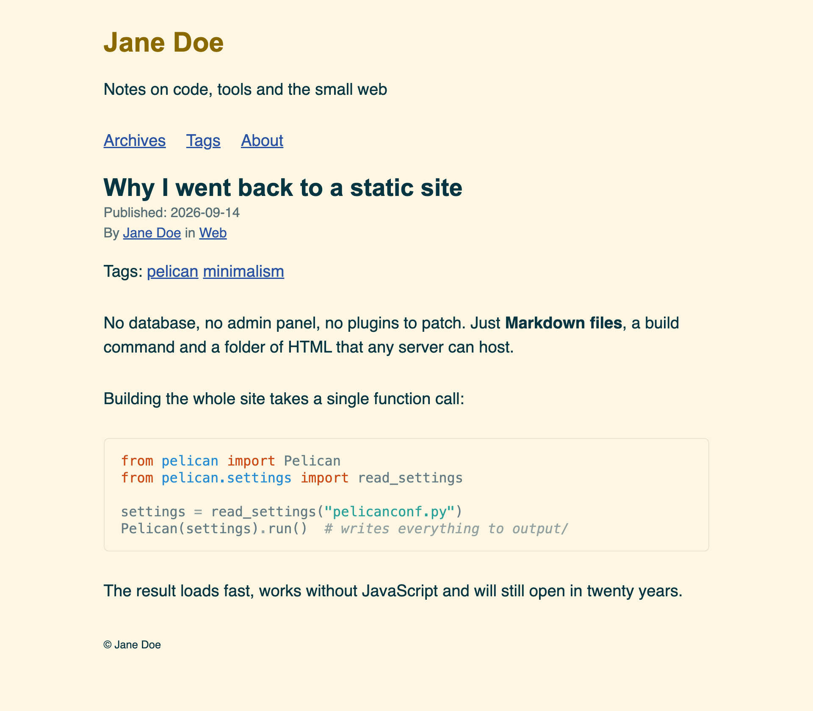
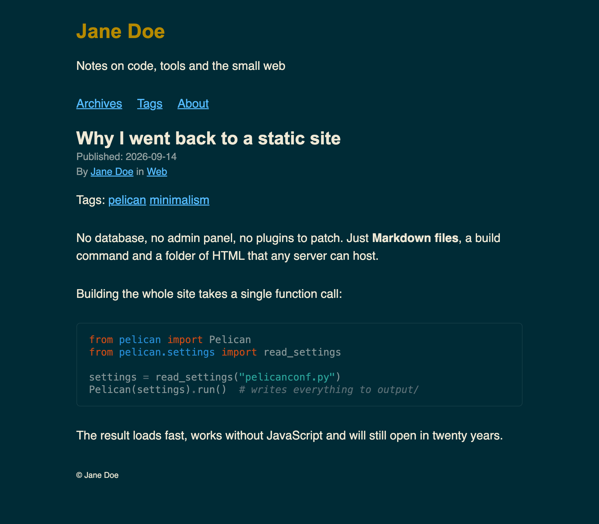

## What is Mofo Solarized

Mofo Solarized is a clean, minimalist, responsive theme for Pelican, supporting light mode, dark mode, or following the system setting.

| Light | Dark |
|---|---|
|  |  |

## Philosophy

The theme is based on the motherfucking websites philosophy:

- https://motherfuckingwebsite.com
- http://bettermotherfuckingwebsite.com
- https://perfectmotherfuckingwebsite.com
- https://evenbettermotherfucking.website
- https://bestmotherfucking.website
- https://thebestmotherfucking.website
- https://thebestmotherfuckingwebsite.co
- https://ultimatemotherfuckingwebsite.com
- https://justfuckingusehtml.com

With some basic colors from the Solarized colour schemes (light and dark).

This is a personal take on a middle ground between minimalism and aesthetics.

## Accessibility

All text, including syntax-highlighted code, meets WCAG AA colour contrast (at least 4.5:1) in both light and dark mode. Solarized's own syntax colours fall short of that, so by default `tools/code_css.py` darkens or lightens each one just enough while keeping its hue. Set `MOFO_CODE_COLORS = 'solarized'` to use the official values instead. Pages use semantic landmarks (`header`, `nav`, `main`, `footer`), set their language, and score 100 in Lighthouse's accessibility audit.

## Requirements

```
pelican
```

Code highlighting uses Pygments, which is installed with Pelican.

## Configuration

Set `THEME` in your Pelican config file to the path of this theme, for example `themes/pelican-mofo-solarized`.

### Theme settings

All settings are optional.

| Setting | Values | Default | Effect |
|---|---|---|---|
| `MOFO_COLOR_SCHEME` | `'light'`, `'dark'`, `'system'` | `'system'` | Site colours. `'system'` follows the reader's OS setting. |
| `MOFO_CODE_SCHEME` | `'light'`, `'dark'`, `'system'` | `'system'` | Code block colours, independent of the site colours. |
| `MOFO_CODE_COLORS` | `'accessible'`, `'solarized'` | `'accessible'` | Syntax colours. `'solarized'` uses the official Solarized values, several of which are below WCAG AA contrast. |
| `MOFO_LICENSE` | dict, see below | not set | License link in the footer. Not shown if unset. |
| `MOFO_OPEN_GRAPH` | `True`, `False` | `True` | Open Graph tags for link previews, see [Link previews](#link-previews-open-graph). |
| `MOFO_OG_IMAGE` | path or URL | not set | Default preview image for every page. |
| `MOFO_DYSLEXIC_FONT` | `True`, `False` | `True` | Lets readers switch to a dyslexia-friendly font, see [Dyslexia-friendly font](#dyslexia-friendly-font). |
| `MOFO_FAVICONS` | `True`, `False` | `False` | Links favicon files, see [Favicons](#favicons). |
| `NOW` | `datetime` | not set | Adds the current year to the footer copyright. |

```python
from datetime import datetime
NOW = datetime.now()

MOFO_COLOR_SCHEME = 'system'
MOFO_CODE_SCHEME = 'dark'

MOFO_LICENSE = {
    'name': 'CC BY-NC 4.0',
    'url': 'https://creativecommons.org/licenses/by-nc/4.0/',
    # optional: paths relative to your site root, or full URLs
    'icons': ['images/license/cc.svg', 'images/license/by.svg', 'images/license/nc.svg'],
}
```

The theme ships no license icons. To show icons, add your own image files to your site, for example in `content/images/license/` (`images` is in Pelican's default `STATIC_PATHS`). The official Creative Commons icons are on the [Creative Commons downloads page](https://creativecommons.org/mission/downloads/).

### Link previews (Open Graph)

By default every page gets [Open Graph](https://ogp.me) tags, which social sites and chat apps use to show a title, description and image when someone shares a link. Set `MOFO_OPEN_GRAPH = False` to remove them.

- **Title and description:** the article's or page's title, and its `Description` metadata (or its summary). Other pages use the page title and `SITESUBTITLE`.
- **Image:** an article's or page's `Og_image` metadata, or else `MOFO_OG_IMAGE`. Use a path relative to your site root (for example `images/card.png`) or a full URL.
- **Articles** also get their dates, category and tags.
- **URLs must be absolute,** so `og:url` and relative images are only added when `SITEURL` is set. Set it in your `publishconf.py`.

```markdown
Title: My article
Description: One sentence shown in link previews.
Og_image: images/my-article.png
```

### Dyslexia-friendly font

The footer has a checkbox that lets readers switch the text to [OpenDyslexic](https://opendyslexic.org). Set `MOFO_DYSLEXIC_FONT = False` to remove it.

- **Works without JavaScript:** the switch is a plain checkbox styled with CSS. A few lines of JavaScript only remember the reader's choice from page to page, in their browser's local storage. Nothing is sent anywhere.
- **No cost for other readers:** the font files ship with the theme, so there are no third-party requests, and browsers only download them when a reader switches the font on.
- **License:** OpenDyslexic is under the SIL Open Font License 1.1, included in `static/fonts/opendyslexic/OFL.txt`.

### Navigation

The header shows a menu built from Pelican's standard settings:

- `MENUITEMS`: extra links, as `(title, url)` pairs
- `DISPLAY_PAGES_ON_MENU`: your pages (Pelican default: `True`)
- `DISPLAY_CATEGORIES_ON_MENU`: your categories (Pelican default: `True`)

Set the last two to `False` to hide those links. If the menu would be empty, it isn't shown.

### Code highlighting

Code is highlighted when the site is built, with no JavaScript. This uses the `codehilite` Markdown extension, which Pelican enables by default. If you set your own `MARKDOWN` setting, keep it enabled with `css_class` set to `highlight`:

```python
MARKDOWN = {
    'extension_configs': {
        'markdown.extensions.codehilite': {'css_class': 'highlight'},
        'markdown.extensions.extra': {},
        'markdown.extensions.meta': {},
    },
    'output_format': 'html5',
}
```

Put the language after the opening fence so the block gets highlighted:

````markdown
```python
print("hello")
```
````

### Favicons

By default the theme links no icon files, so nothing returns a 404. Set `MOFO_FAVICONS = True` to link these files at the root of your site: `favicon.ico`, `favicon-16x16.png`, `favicon-32x32.png`, `apple-icon-180x180.png` and `manifest.json`.

Put them in `content/extra/` and copy them to the root:

```python
MOFO_FAVICONS = True
STATIC_PATHS = ['images', 'extra']
EXTRA_PATH_METADATA = {
    'extra/favicon.ico': {'path': 'favicon.ico'},
    'extra/favicon-16x16.png': {'path': 'favicon-16x16.png'},
    'extra/favicon-32x32.png': {'path': 'favicon-32x32.png'},
    'extra/apple-icon-180x180.png': {'path': 'apple-icon-180x180.png'},
    'extra/manifest.json': {'path': 'manifest.json'},
}
```

## Example configuration

```python
AUTHOR = 'John Doe'
SITENAME = 'John Doe'
SITEURL = ''

PATH = 'content'
THEME = 'themes/pelican-mofo-solarized'

TIMEZONE = 'UTC'
DEFAULT_LANG = 'en'

FEED_ALL_ATOM = 'rss.xml'
CATEGORY_FEED_ATOM = None
TRANSLATION_FEED_ATOM = None
AUTHOR_FEED_ATOM = None
AUTHOR_FEED_RSS = None

DEFAULT_PAGINATION = 10
```

## Development

The `demo/` folder holds a small site that uses every feature of the theme. You need Pelican installed (`pip install pelican markdown`).

```sh
make serve                       # build the demo, serve it on http://localhost:8000, rebuild on changes
make serve COLOR=dark CODE=light # try other colour schemes
make serve CODE_COLORS=solarized # official Solarized code colours
make demo                        # build only, into demo/output
make css                         # regenerate the code colour stylesheets (tools/code_css.py)
```

Tested with Pelican 4.12.
